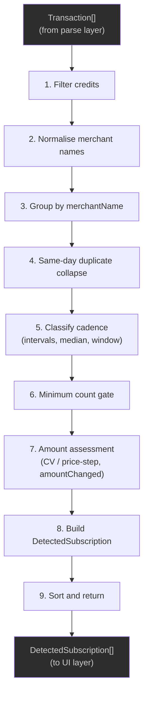

# Design Document: recurring-charge-detector

## Overview

The recurring-charge detector is a pure-function module (`src/detect/`) that takes a `Transaction[]`
from the existing parse layer and returns a `DetectedSubscription[]` ready for the UI to render as
tombstones in Subscription Graveyard.

**Key design decisions:**

- **No DOM access, no side effects.** Every function in `src/detect/` is a pure transformation over
  plain data structures. This keeps the module trivially testable and reusable.
- **Integer-only money arithmetic.** Amounts never leave integer minor units (sen, cents). CV
  computation divides integers at the very last step, only to compare against a threshold, never to
  store a result.
- **ISO-string dates throughout.** Calendar-day differences are computed with `Date.UTC` subtraction
  so no timezone shifts can affect results.
- **Pipeline architecture.** The main `detectSubscriptions` function is a linear sequence of small,
  named steps. Each step can be unit-tested independently; the pipeline is integration-tested by the
  fixture suite.

---

## Architecture



The module has **no dependencies** on the UI layer or the DOM. It imports only from `src/parse/types.ts`
(the `Transaction` type).

---

## Components and Interfaces

### File layout

```
src/detect/
  types.ts                              -- DetectedSubscription, Cadence, Confidence
  normaliseMerchant.ts                  -- Req 1 merchant normalisation
  computeIntervals.ts                   -- calendar-day diff and median helpers
  classifyCadence.ts                    -- Median_Interval -> cadence label
  assessAmounts.ts                      -- CV, price-step, typical/latest/amountChanged
  detectSubscriptions.ts               -- main pipeline
  index.ts                              -- public re-exports
  __tests__/
    detector.property.test.ts          -- fast-check property tests (Req 11)
    detector.fixture.test.ts           -- sample CSV fixture tests (Req 12)
```

### Function signatures

#### `src/detect/types.ts`

```typescript
export type Cadence = "weekly" | "monthly" | "quarterly" | "annual";
export type Confidence = "confirmed" | "possible";

export interface DetectedSubscription {
  merchantName: string;
  cadence: Cadence;
  typicalAmountMinorUnits: number;   // positive integer >= 1
  latestAmountMinorUnits: number;    // positive integer >= 1
  currency: string;                  // ISO 4217
  firstCharge: string;               // ISO date YYYY-MM-DD
  lastCharge: string;                // ISO date YYYY-MM-DD
  chargeCount: number;               // occurrences after duplicate suppression
  confidence: Confidence;
  isActive: boolean;
  amountChanged: boolean;
}
```

#### `src/detect/normaliseMerchant.ts`

```typescript
/**
 * Strips trailing reference-number tokens (any whitespace-delimited token
 * containing at least one digit) from a transaction description, then
 * collapses whitespace and upper-cases the result.
 *
 * The first token is NEVER stripped, even if it contains a digit.
 *
 * @param description - Raw description string from a Transaction.
 * @returns Normalised merchant name, or "" for blank/whitespace-only input.
 */
export function normaliseMerchant(description: string): string;
```

#### `src/detect/computeIntervals.ts`

```typescript
/**
 * Returns the number of whole calendar days between two ISO date strings.
 * Always non-negative; callers must pass dates in chronological order.
 */
export function daysBetween(earlier: string, later: string): number;

/**
 * Given a sorted array of ISO date strings, returns the array of pairwise
 * consecutive day-gaps.
 * Returns [] when dates has fewer than 2 elements.
 */
export function computeGaps(dates: readonly string[]): number[];

/**
 * Returns the median of a non-empty array of numbers.
 * For even-length arrays, returns the lower of the two middle values.
 * Returns null for an empty array.
 */
export function median(values: readonly number[]): number | null;
```

#### `src/detect/classifyCadence.ts`

```typescript
/**
 * Cadence windows with drift expansion applied (+/- 5 days on each boundary).
 *
 *   weekly:    3-10  -> effective 0-15   (clamped to >= 0)
 *   monthly:   25-45 -> effective 20-50
 *   quarterly: 80-100 -> effective 75-105
 *   annual:    330-400 -> effective 325-405
 */

/**
 * Maps a Median_Interval (in calendar days) to a cadence label.
 * Returns null when the interval falls outside all expanded windows.
 */
export function classifyCadence(medianInterval: number): Cadence | null;

/**
 * Minimum occurrence counts required for each cadence before the series is
 * included in output.
 */
export const MIN_OCCURRENCES: Readonly<Record<Cadence, number>>;

/**
 * Look-back distances (in days) used to determine isActive for each cadence.
 */
export const ACTIVE_LOOKBACK: Readonly<Record<Cadence, number>>;
```

#### `src/detect/assessAmounts.ts`

```typescript
/** Result of assessing the amount variability of a series. */
export interface AmountAssessment {
  /** Median amountMinorUnits; lower of two middles for even counts. */
  typicalAmountMinorUnits: number;
  /** amountMinorUnits of the most recent occurrence. */
  latestAmountMinorUnits: number;
  /** true when latestAmountMinorUnits !== typicalAmountMinorUnits. */
  amountChanged: boolean;
  /**
   * true when the series passes the amount-variability gate:
   *   - CV <= 0.10, OR
   *   - clean price-step exemption (<=2 distinct amounts, >=3 occurrences, >=2 share one amount).
   */
  passes: boolean;
}

/**
 * Computes the population coefficient of variation for a series of
 * positive-integer minor-unit amounts. Uses integer arithmetic throughout;
 * returns a floating-point ratio only for the final comparison.
 * Returns 0 when all amounts are equal.
 */
export function computeCV(amounts: readonly number[]): number;

/**
 * Assesses amount variability for one merchant series.
 *
 * @param amounts - Amounts in chronological order (after dedup); all positive integers.
 */
export function assessAmounts(amounts: readonly number[]): AmountAssessment;
```

#### `src/detect/detectSubscriptions.ts`

```typescript
/**
 * Main entry point for the recurring-charge detector.
 *
 * Takes a parsed transaction list and returns detected subscriptions sorted
 * by typicalAmountMinorUnits descending, then merchantName ascending.
 *
 * All transactions with amountMinorUnits <= 0 are excluded before analysis.
 * No DOM access. No side effects.
 *
 * @param transactions - Normalised transactions from the parse layer.
 * @returns Sorted array of detected subscriptions.
 */
export function detectSubscriptions(
  transactions: readonly Transaction[]
): DetectedSubscription[];
```

#### `src/detect/index.ts`

```typescript
export { detectSubscriptions } from "./detectSubscriptions.js";
export type { DetectedSubscription, Cadence, Confidence } from "./types.js";
```

---

## Data Models

### Internal types (not exported from `index.ts`)

These types are used within the pipeline and are not part of the public API.

```typescript
/** A single occurrence after same-day duplicate suppression. */
interface Occurrence {
  date: string;             // ISO YYYY-MM-DD
  amountMinorUnits: number; // positive integer
  currency: string;         // ISO 4217
}

/**
 * All occurrences for one merchant, in chronological order,
 * after credit filtering and same-day duplicate suppression.
 */
interface MerchantSeries {
  merchantName: string;
  occurrences: Occurrence[]; // sorted ascending by date
}
```

### Pipeline data flow

```
Transaction[]
  |
  v
[filter: amountMinorUnits > 0]
  |
  v  add merchantName field via normaliseMerchant(description)
[group by merchantName]
  |
  v  collapse same-date entries: sum amounts (guard: sum <= 999,999,999)
MerchantSeries[]
  |
  v  computeGaps -> median -> classifyCadence  (null -> skip)
  v  chargeCount < MIN_OCCURRENCES[cadence]    (true -> skip)
  v  assessAmounts -> passes === false          (true -> skip)
  |
  v
DetectedSubscription[]  (unsorted)
  |
  v  sort: typicalAmountMinorUnits DESC, merchantName ASC
DetectedSubscription[]  (final)
```

### Same-day deduplication guard

When collapsing same-day transactions, the summed amount is checked against
`999_999_999` minor units. If the sum would exceed that value, all original
transactions for that date are kept as separate occurrences. This prevents
overflow artifacts from masking a legitimate split-debit billing event.

### isActive computation

The reference date used for `isActive` is the **latest `date` among all input
transactions** (before any filtering). This means even a large credit transaction
(e.g. a salary deposit near the end of the period) anchors the look-back window
correctly.

```
latestInputDate = max(transaction.date for all input transactions)
isActive = daysBetween(lastCharge, latestInputDate) <= ACTIVE_LOOKBACK[cadence]
```

### Confidence assignment

Under the current requirements all series that survive the full pipeline are
assigned `"confirmed"`. The `"possible"` label is reserved for future use (e.g.
a series below minimum count that the user forces through a manual override).
No series currently exits the pipeline with `"possible"`.

---

## Correctness Properties

*A property is a characteristic or behavior that should hold true across all valid executions of a
system — essentially, a formal statement about what the system should do. Properties serve as the
bridge between human-readable specifications and machine-verifiable correctness guarantees.*

### Property 1: Order-independence

*For any* non-empty list of valid transactions, shuffling the list in any order produces a
`DetectedSubscription[]` that is identical (same merchantNames, same field values, same sort order)
to the result produced by the original order.

**Validates: Requirements 11.1**

### Property 2: Monthly series with bounded drift is always detected

*For any* synthetically generated monthly series of at least 2 occurrences where each interval is
drawn from [27, 33] days (base 30 ± 3), the detector SHALL return a result containing an entry with
`cadence === "monthly"` for that merchant.

**Validates: Requirements 11.2, 4.2, 5.1**

### Property 3: All typical amounts are positive

*For any* non-empty input, every `typicalAmountMinorUnits` in the output is a positive integer
strictly greater than 0.

**Validates: Requirements 11.3, 9.4**

### Property 4: All-credit input yields empty output

*For any* list of transactions where every `amountMinorUnits` is <= 0, the detector SHALL return
an empty array.

**Validates: Requirements 11.4, 2.1, 2.2**

### Property 5: firstCharge is not after lastCharge

*For any* valid detected subscription, `firstCharge` is lexicographically less than or equal to
`lastCharge`.

**Validates: Requirements 11.5, 9.7, 9.8**

### Property 6: Numeric suffixes do not affect grouping

*For any* merchant base name and any two distinct numeric suffixes, transactions whose descriptions
are `"<base> <suffix1>"` and `"<base> <suffix2>"` SHALL be grouped under the same `merchantName`
as a transaction with description `"<base>"` alone.

**Validates: Requirements 11.6, 1.1, 1.4**

### Property 7: Unrelated merchants do not disturb existing results

*For any* input list L that produces a detected subscription S, appending transactions from an
unrelated merchant (a normalised name not present in L) to L SHALL NOT change the `merchantName`,
`cadence`, `typicalAmountMinorUnits`, `latestAmountMinorUnits`, `confidence`, `firstCharge`,
`lastCharge`, or `chargeCount` of S in the output.

**Validates: Requirements 11.7**

---

## Error Handling

The detector is a pure function and does not throw. It handles degenerate input defensively:

| Situation | Behaviour |
|---|---|
| Empty `transactions` array | Returns `[]` |
| All transactions are credits (`amountMinorUnits <= 0`) | Returns `[]` |
| Single transaction for a merchant | Filtered out (below minimum count for all cadences) |
| `amountMinorUnits` of 0 exactly | Treated as a credit; excluded |
| Same-day sum overflow (> 999,999,999) | Transactions kept separate (not collapsed) |
| `description` is blank or whitespace-only | `normaliseMerchant` returns `""`; transactions group under the empty-string merchant and are almost certainly filtered by minimum count |
| Median interval outside all expanded windows | Series excluded from output silently |
| CV > 0.10 and more than 2 distinct amounts | Series excluded from output silently |

No errors are propagated to the UI layer from this module. The UI may inspect
the length of the returned array to decide whether to show the empty-state screen.

---

## Testing Strategy

### Dual-layer approach

**Unit tests** cover specific examples and edge conditions within individual helper functions:
- `normaliseMerchant`: blank input, single token, digit-only suffix, 7-ELEVEN edge case
- `daysBetween`: same date, leap-year boundary, 365-day span
- `computeGaps`: fewer than 2 dates, chronological order
- `median`: single element, odd count, even count (lower-of-two rule)
- `classifyCadence`: boundary values at each window edge, values outside all windows
- `assessAmounts`: CV=0 series, CV just above/below 0.10, clean price-step exemption, non-exempt two-occurrence series
- `detectSubscriptions`: the sample-CSV fixture (Req 12)

**Property-based tests** (fast-check, minimum 100 iterations each) verify the 7 correctness
properties from Req 11. The library is already a dev dependency (`fast-check ^3.19.0`).

### fast-check generator strategies

**Property 1 — Order-independence**
- Generator: `fc.array(transactionArbitrary(), { minLength: 2, maxLength: 50 })`
  then `fc.shuffledSubarray` or `fc.permutation` on the generated list.
- Assert: `detectSubscriptions(shuffled)` deeply equals `detectSubscriptions(original)`.
- Tag: `Feature: recurring-charge-detector, Property 1: order-independence`

**Property 2 — Monthly drift detection**
- Generator: `fc.record({ merchantName: fc.string({ minLength: 1 }), count: fc.integer({ min: 2, max: 8 }) })`
  then build transactions with dates spaced 30 ± `fc.integer({ min: 0, max: 3 })` days apart,
  amounts `fc.integer({ min: 100, max: 100_000 })` (all equal to keep CV=0).
- Assert: output contains an entry with the expected `merchantName` and `cadence === "monthly"`.
- Tag: `Feature: recurring-charge-detector, Property 2: monthly drift detection`

**Property 3 — Positive typical amounts**
- Generator: `fc.array(transactionArbitrary(), { minLength: 1, maxLength: 100 })`.
- Assert: every element of the output satisfies `typicalAmountMinorUnits >= 1`.
- Tag: `Feature: recurring-charge-detector, Property 3: positive typical amounts`

**Property 4 — All-credit empty output**
- Generator: `fc.array(fc.record({ date: isoDateArbitrary(), description: fc.string(), amountMinorUnits: fc.integer({ max: 0 }), currency: fc.constant("MYR") }), { minLength: 1 })`.
- Assert: `detectSubscriptions(input).length === 0`.
- Tag: `Feature: recurring-charge-detector, Property 4: all-credit empty output`

**Property 5 — firstCharge <= lastCharge**
- Generator: `fc.array(transactionArbitrary(), { minLength: 1, maxLength: 100 })`.
- Assert: for every result, `result.firstCharge <= result.lastCharge` (lexicographic).
- Tag: `Feature: recurring-charge-detector, Property 5: firstCharge <= lastCharge`

**Property 6 — Numeric suffixes do not affect grouping**
- Generator: a fixed merchant base name `fc.string({ minLength: 1, maxLength: 20 })` (all alpha)
  combined with two distinct numeric suffixes `fc.nat()`. Build a monthly series using
  `"<base> <suffix1>"` and `"<base> <suffix2>"` alternating.
- Assert: output contains exactly one entry and its `merchantName` equals `normaliseMerchant(base)`.
- Tag: `Feature: recurring-charge-detector, Property 6: numeric suffix grouping`

**Property 7 — Unrelated merchants do not disturb results**
- Generator: a base transaction list that is known to produce at least one subscription S, plus
  `fc.array(unrelatedTransactionArbitrary(existingNames), { minLength: 1, maxLength: 20 })`.
- Assert: S's core fields in `detectSubscriptions(base ++ extra)` match those in
  `detectSubscriptions(base)`.
- Tag: `Feature: recurring-charge-detector, Property 7: unrelated merchant isolation`

### Test file locations

| File | Purpose |
|---|---|
| `src/detect/__tests__/detector.property.test.ts` | Properties 1-7 using fast-check |
| `src/detect/__tests__/detector.fixture.test.ts` | Req 12 sample-CSV fixture |
| `src/detect/__tests__/normaliseMerchant.test.ts` | Unit tests for Req 1 |
| `src/detect/__tests__/computeIntervals.test.ts` | Unit tests for helpers |
| `src/detect/__tests__/classifyCadence.test.ts` | Unit tests for Req 4 and 5 |
| `src/detect/__tests__/assessAmounts.test.ts` | Unit tests for Req 7 and 8 |

### Coverage expectations

- Every exported function in `src/detect/` has at least one unit test (tech steering requirement).
- Every property in the Correctness Properties section above has exactly one `fc.assert` call.
- The fixture test covers all 16 assertions from Req 12.
